# Structure from Motion: Sparse 3D Reconstruction

A Python implementation of a Structure from Motion (SfM) pipeline that estimates camera poses and reconstructs a sparse 3D scene from images captured at different viewpoints.

## Overview

The pipeline identifies matching image features, estimates the relative motion between cameras, and triangulates corresponding points to recover a sparse 3D structure. Camera rotations and translations are expressed in a shared coordinate system, allowing the reconstructed scene and camera poses to be visualized together.

## Features

- SIFT keypoint detection and descriptor extraction.
- Feature matching with FLANN and Lowe's ratio test.
- Robust essential matrix estimation using RANSAC.
- Relative camera pose recovery with cheirality checks.
- Absolute camera rotation estimation by chaining relative rotations.
- Robust camera translation estimation using known rotations and 3D-to-2D correspondences.
- DLT triangulation and filtering of unreliable 3D points.
- Visualization of sparse 3D points and camera poses.
- Interactive selection of datasets numbered **1-9**.

## Requirements

The project report specifies **Python 3.11.9** and the following libraries:

| Library | Purpose |
| --- | --- |
| NumPy | Numerical computations and matrix operations |
| OpenCV | Image loading, feature extraction, and matching |
| SciPy | Numerical methods and linear algebra |
| Pillow | Image handling and format support |
| Matplotlib | Plotting and 3D visualization |

Install the dependencies in your Python environment:

```bash
python -m pip install numpy opencv-python scipy pillow matplotlib
```

## Project Files

Keep the following Python files and the dataset image folders together in the project directory, preserving the dataset paths expected by the implementation:

| File | Role |
| --- | --- |
| `main.py` | Entry point; prompts for a dataset number and starts the pipeline |
| `run_sfm.py` | Contains the `run_sfm` function implementing the SfM pipeline |
| `project_helpers.py` | Supporting project utilities |
| `helper_functions.py` | Supporting helper functions |

Dataset information is loaded using `get_dataset_info(dataset_num)`, which provides the camera calibration matrix, image filenames, initial image pair, and RANSAC pixel threshold.

## Usage

From the project directory, run:

```bash
python main.py
```

When prompted, enter a dataset number from **1 to 9**. The pipeline processes the selected image sequence, estimates camera motion, reconstructs sparse 3D points, and generates visualizations.

## Pipeline

1. **Load dataset information.** Read camera calibration, image paths, the initial image pair, and the RANSAC threshold.
2. **Estimate relative camera poses.** Extract and match SIFT features for consecutive images. Normalize image coordinates using the camera calibration matrix, estimate the essential matrix with RANSAC, and select a pose using a cheirality check so that triangulated points lie in front of both cameras.
3. **Compute absolute rotations.** Use the first camera as the orientation reference and chain relative rotations across the sequence. Check rotation orthogonality as a sanity check.
4. **Initialize the 3D reconstruction.** Match a selected image pair with sufficient baseline, estimate its relative pose, and triangulate initial 3D points. Align their orientation to the common frame and retain their descriptors for later matching.
5. **Estimate camera translations.** Match descriptors associated with the initial 3D points to features in each image. With rotations fixed, use a two-correspondence DLT translation estimator inside RANSAC. Evaluate the estimated translations using reprojection errors.
6. **Triangulate across the sequence.** Use the estimated absolute camera poses to reconstruct points from consecutive image pairs. Remove points behind the cameras and distant outliers.
7. **Visualize the result.** Plot the full sparse reconstruction with camera poses, followed by a cleaner view using a subset of the points.

## Outputs and Results

The implementation produces:

- A complete sparse 3D reconstruction with estimated camera poses.
- A cleaner visualization with fewer plotted points.
- Diagnostic output, including inlier counts, rotation checks, estimated translations, and mean and median reprojection errors.


## Results

### Dataset 1
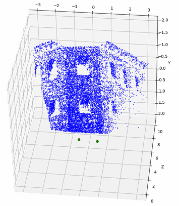
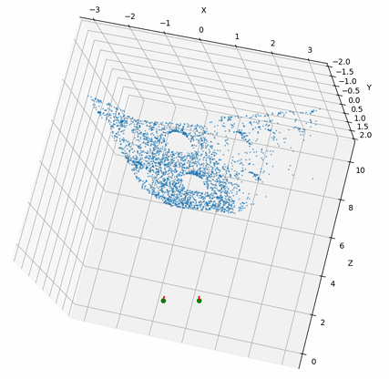

### Dataset 2
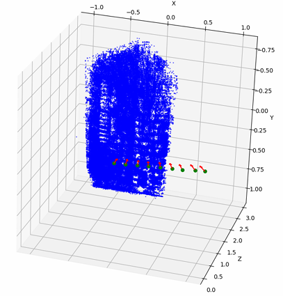
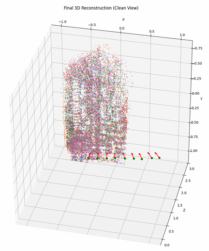

### Dataset 3
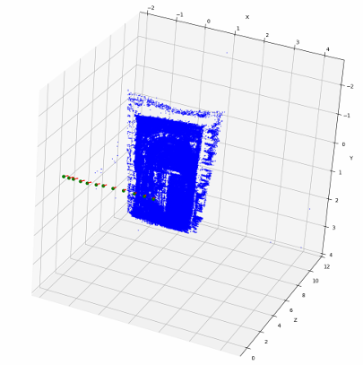
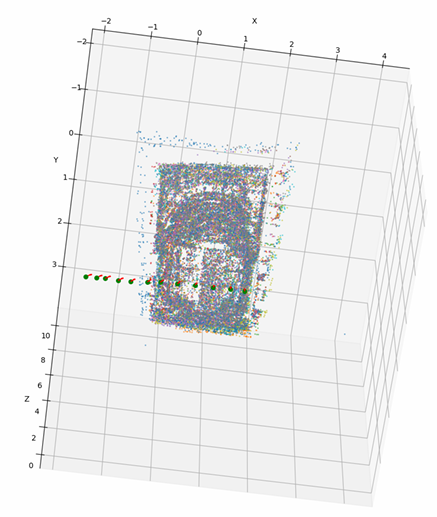
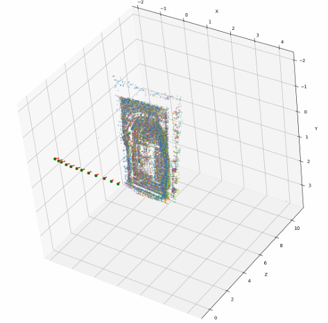

### Dataset 4
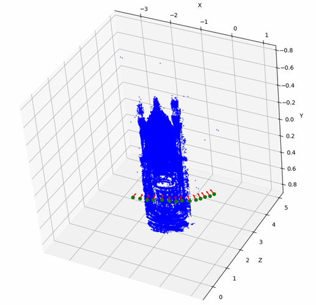
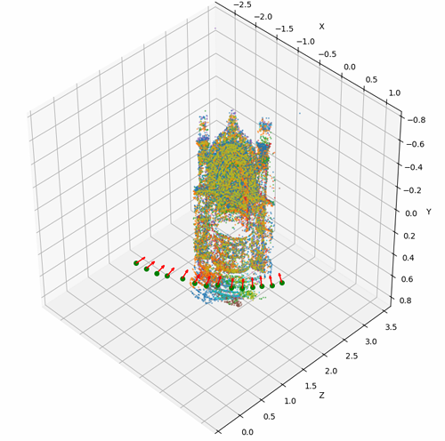
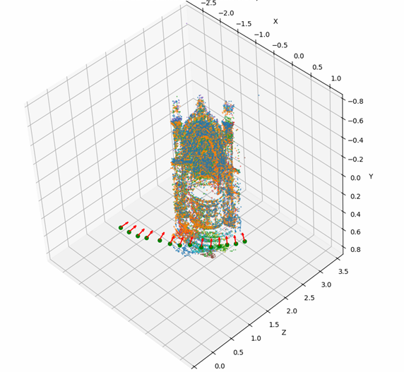

### Dataset 5
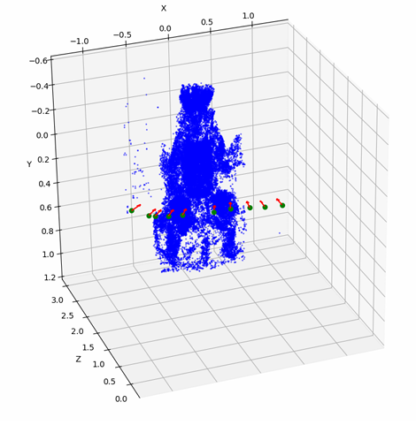
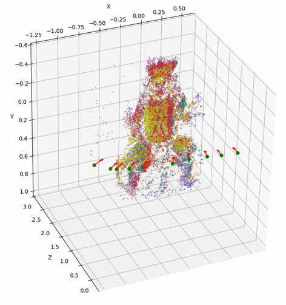
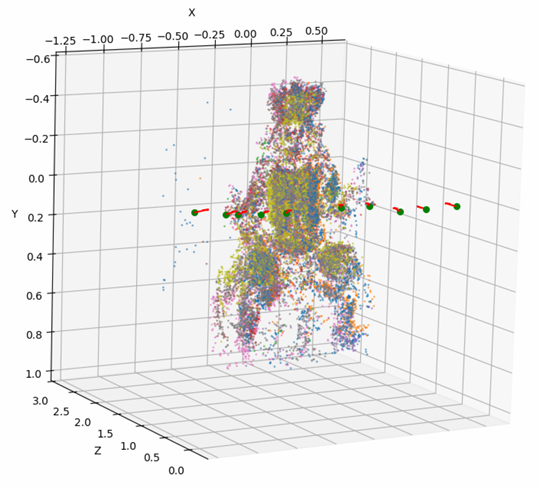
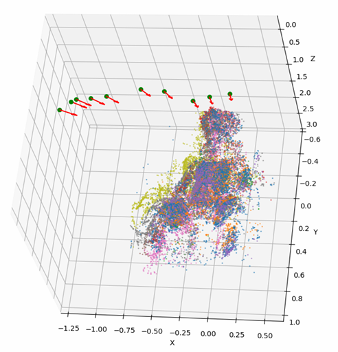

### Dataset 6
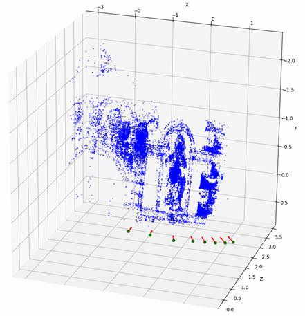
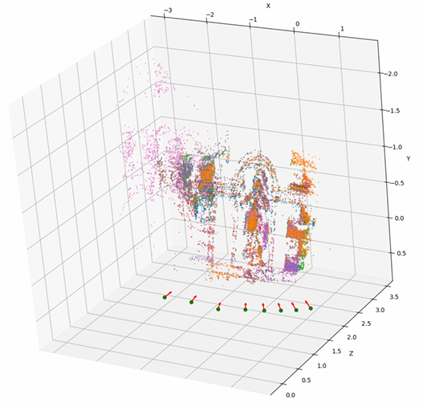
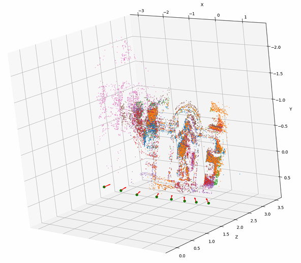

### Dataset 7
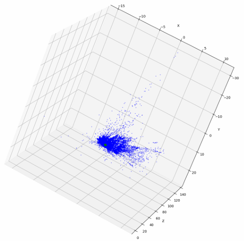
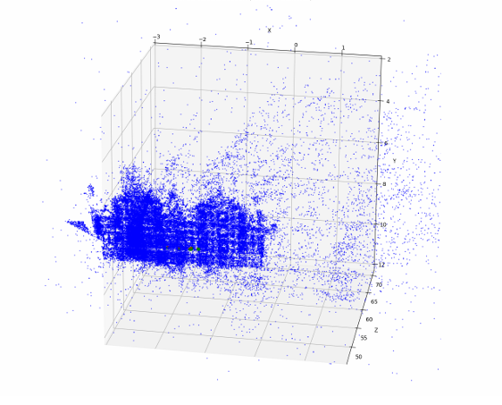
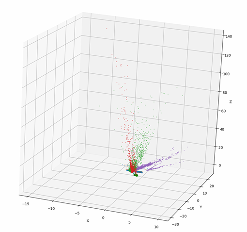
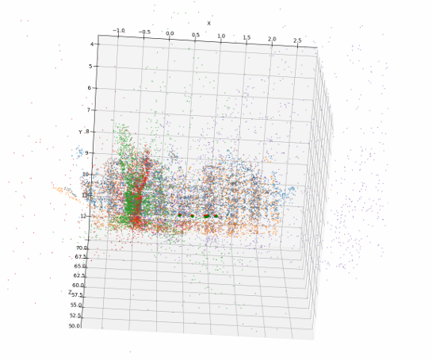

### Dataset 8
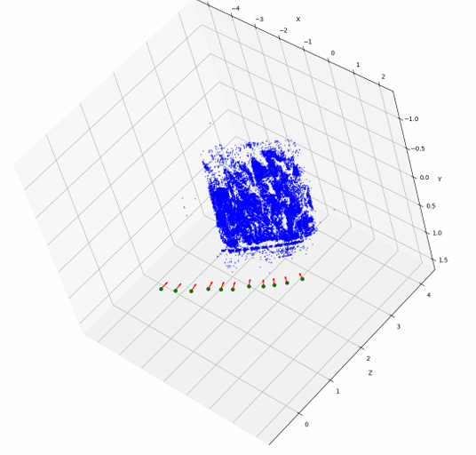
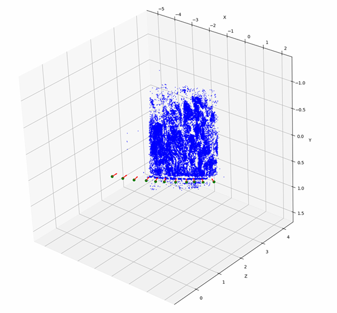
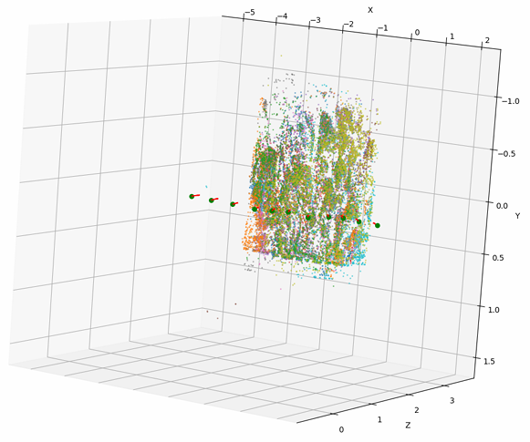
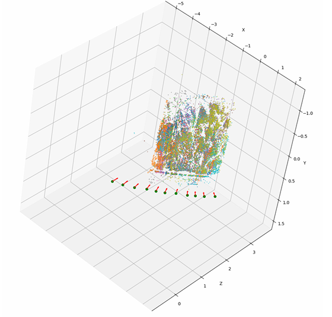

### Dataset 9
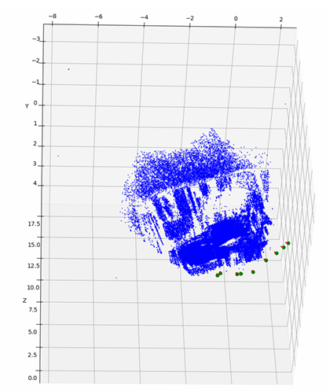
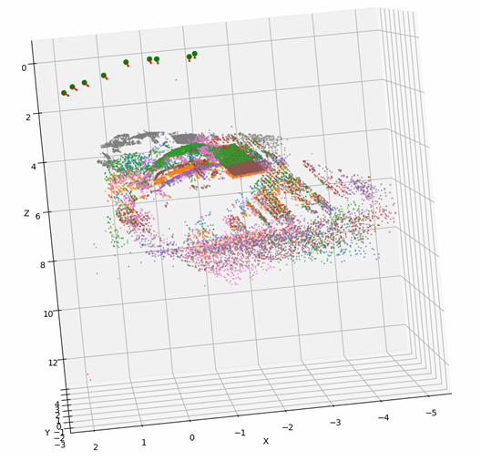
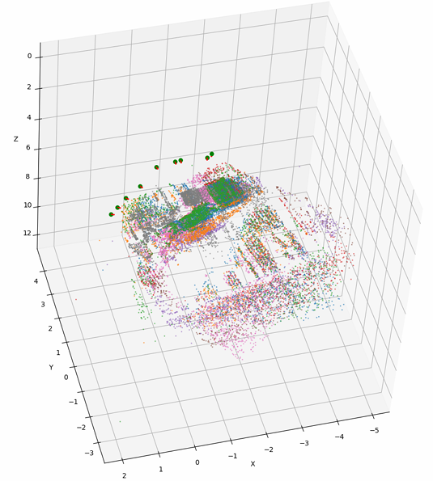